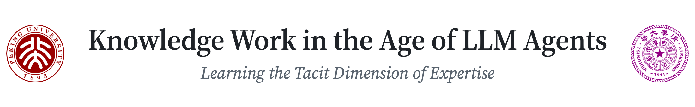
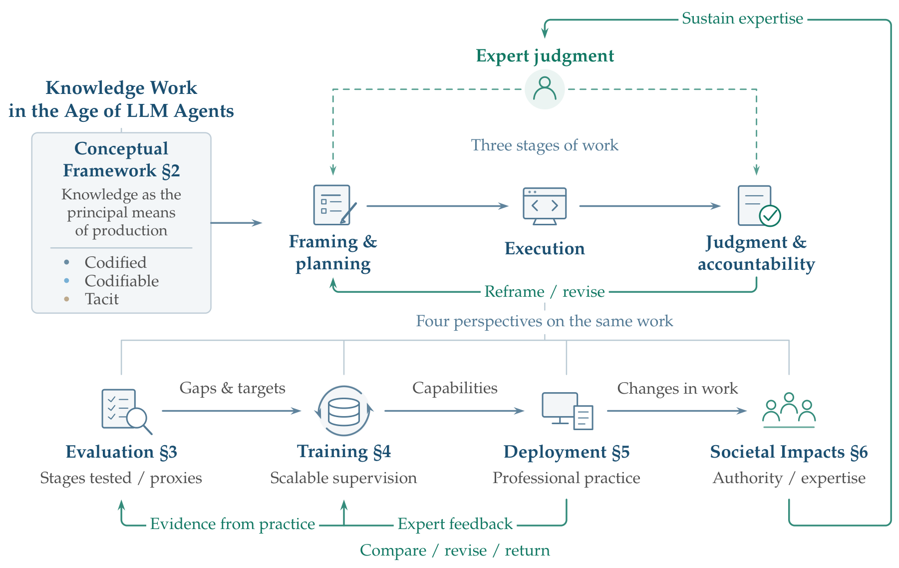
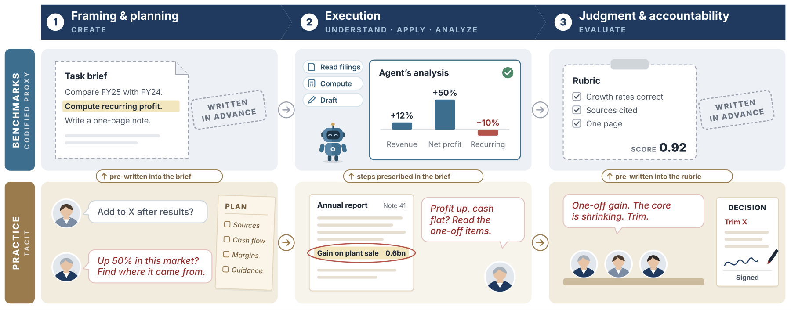
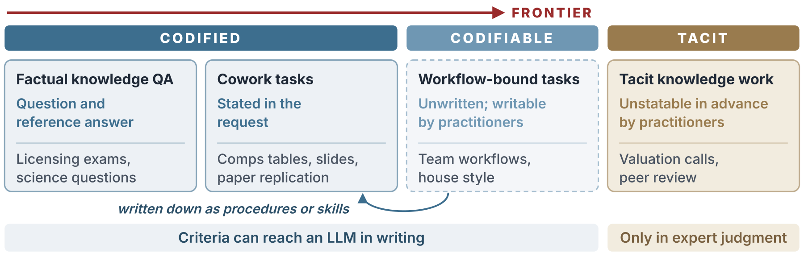
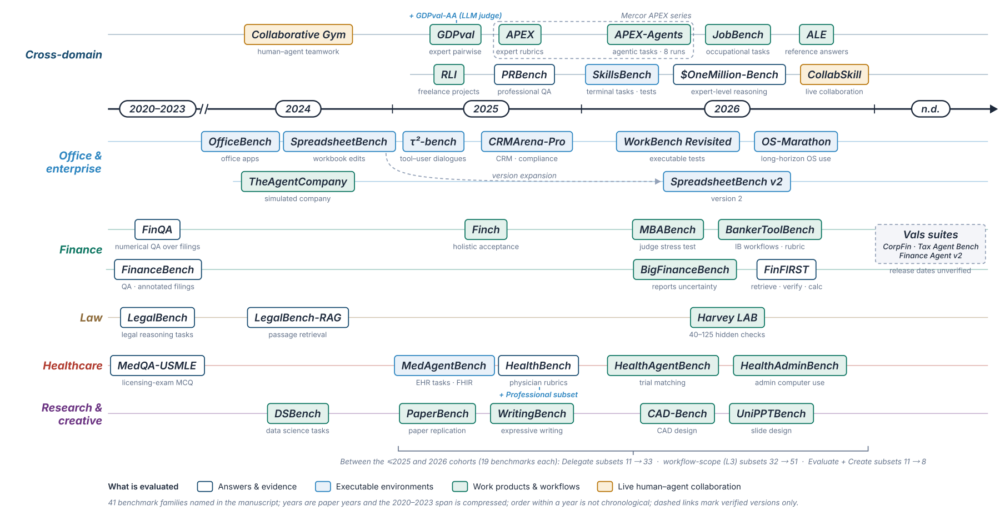
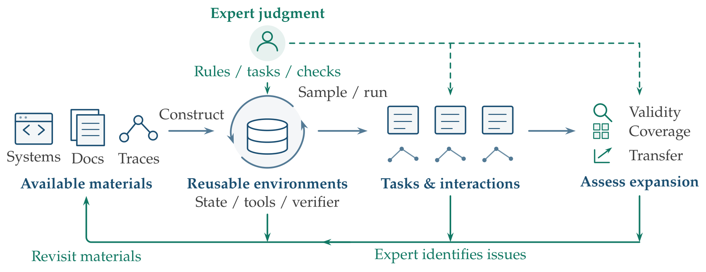
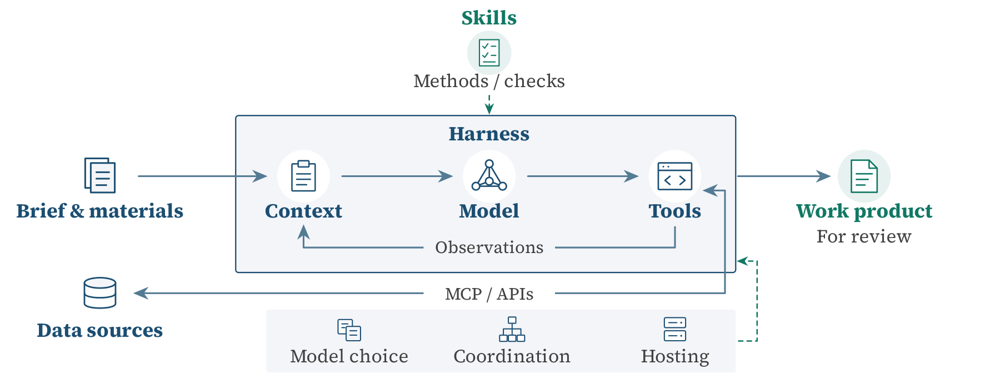
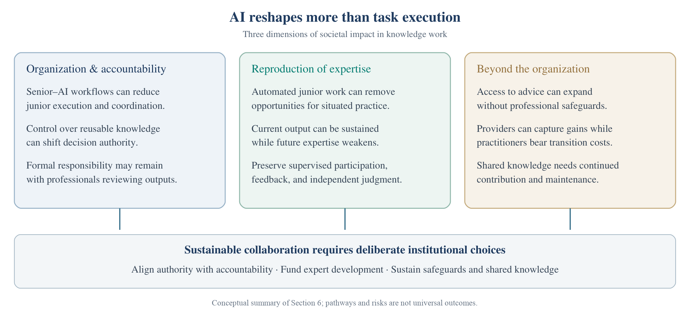

<div align="center">

<picture>
  <source media="(prefers-color-scheme: dark)" srcset="resources/figures/banner-dark.png">
  
</picture>

<p>
<a href="survey.pdf"></a>
<a href="resources/literature/README.md"></a>
<a href="#news"></a>
</p>

<p><i>“We can know more than we can tell.”</i> &nbsp;— Michael Polanyi, <i>The Tacit Dimension</i> (1966)</p>



</div>

<br>

> **TL;DR** LLM agents increasingly handle knowledge work whose success criteria can be written down. The frontier is **tacit knowledge work**, whose criteria experts cannot state in advance. Agents will need to learn these criteria from what experts choose, revise, and return, without eroding the junior work through which new experts are trained.

## <br>News

- **2026-11-06** · Preprint released in this repository.

## <br>Contents

- [**Overview**](#overview) — codified, codifiable, and tacit knowledge work, and the three stages of a task
- [**Key Findings**](#key-findings) — what the survey finds across evaluation, training, deployment, and society
- [**Literature Map**](#literature-map) — representative works for each section, with every cited work in the [Paper List](resources/literature/README.md)
- [**Contributing and Collaboration**](#contributing-and-collaboration) — literature suggestions, and contact for practitioners and researchers
- [**Citation**](#citation) — BibTeX entry for the survey

## <br>Overview

LLMs now pass professional licensing examinations and carry out well-specified office tasks, yet on assignments drawn from real practice they rarely deliver work that could be signed off as it stands. We locate the difficulty inside knowledge work.

- **Knowledge work** is work in which knowledge is the principal means of production. It draws on factual knowledge, procedural knowledge, and expert experience.
- Knowledge work is **codified** when its success criteria have been written down, as in factual knowledge QA and cowork tasks; **codifiable** when practitioners could write them down, as with a team's workflow; and **tacit** when those who apply them cannot state them in advance.
- **Tacit knowledge** is the part of expert experience that cannot readily be stated as general rules. It weighs most heavily at the two ends of a task: framing and planning, and judgment and accountability.

<p align="center"></p>

*The three stages of knowledge work in an equity-research case. Top: a codified proxy of the case, as typically set up for evaluating and training LLM agents. Bottom: the same case in professional practice, where tacit knowledge surfaces at every stage, most heavily in framing and judgment.*

## <br>Key Findings

- **Benchmarks test codified proxies.** Across **194 task subsets** from **44 benchmarks**, the brief sets the goal in every one, and the model chooses its own method in only **19%**. Briefs and rubrics turn tacit knowledge work into codified proxies of it.
- **The second Polanyi paradox.** LLMs learn tasks without experts stating the rules, yet their success criteria still arrive in written form: briefs, rubrics, rewards, and skills. These forms carry codified and codifiable criteria well and tacit criteria poorly. Expert acts of comparing, revising, and returning work can carry what written criteria leave out.
- **The periphery problem.** The codified or codifiable junior work through which professions train new experts is the work AI absorbs first.
- **Our position.** Execution will be increasingly automated. Framing and judgment should become collaborative, with agents proposing and professionals deciding and answering for the result.

## <br>Literature Map

Representative works for each section of the survey. The **[Paper List](resources/literature/README.md)** collects every work the survey cites, with one page per section organized by topic, and short reading paths for common questions.

<!-- PAPERS:START -->
### Section 2 · Conceptual Framework

What knowledge work is, how codified, codifiable, and tacit knowledge differ, and the three stages of a task.

<p align="center"></p>

- The Tacit Dimension — *Polanyi, Doubleday, 1966*
- [Tacit and Explicit Knowledge](https://doi.org/10.7208/chicago/9780226113821.001.0001) — *Collins, University of Chicago Press, 2010*
- [The Explicit Economics of Knowledge Codification and Tacitness](https://doi.org/10.1093/icc/9.2.211) — *Cowan et al., Industrial and Corporate Change, 2000*
- Landmarks of Tomorrow — *Drucker, Harper & Brothers, 1959*

**[Browse all 31 works in this section →](resources/literature/conceptual-framework.md)**

### Section 3 · Evaluation

Benchmarks for professional work, how their tasks are built, and how open-ended outputs are scored.

<p align="center"></p>

- [GDPval: Evaluating AI Model Performance on Real-World Economically Valuable Tasks](https://arxiv.org/html/2510.04374) — *Patwardhan et al., arXiv, 2025*
- [Introducing Harvey's Legal Agent Benchmark](https://www.harvey.ai/blog/introducing-harveys-legal-agent-benchmark) — *Harvey, 2026*
- [APEX-Agents](https://arxiv.org/html/2601.14242v3) — *Vidgen et al., arXiv, 2026*
- [HealthBench: Evaluating Large Language Models Towards Improved Human Health](https://arxiv.org/abs/2505.08775) — *Arora et al., arXiv, 2025*

**[Browse all 36 works in this section →](resources/literature/evaluation.md)**

### Section 4 · Training

Training environments, synthesized expert reasoning, and rubrics turned into rewards.

<p align="center"></p>

- [SWE-smith: Scaling Data for Software Engineering Agents](https://arxiv.org/abs/2504.21798v1) — *Yang et al., arXiv, 2025*
- [EnterpriseBench Corecraft: Training Generalizable Agents on High-Fidelity RL Environments](https://arxiv.org/abs/2602.16179v5) — *Mehta et al., arXiv, 2026*
- [Rubrics as Rewards: Reinforcement Learning Beyond Verifiable Domains](https://arxiv.org/abs/2507.17746v2) — *Gunjal et al., arXiv, 2025*
- [Augmenting Human Preference in Complex Domains](https://www.harvey.ai/blog/augmenting-human-preference-in-complex-domains) — *Pereyra, 2026*

**[Browse all 32 works in this section →](resources/literature/training.md)**

### Section 5 · Deployment

Professional data and context, skills and procedures, tools and harnesses, and specialized models.

<p align="center"></p>

- [ReAct: Synergizing Reasoning and Acting in Language Models](https://arxiv.org/abs/2210.03629) — *Yao et al., ICLR, 2023*
- [Model Context Protocol: Architecture Overview](https://modelcontextprotocol.io/docs/2026-07-28/learn/architecture) — *Model Context Protocol Contributors, 2026*
- [Agent Skills Specification](https://agentskills.io/specification) — *Agent Skills, 2026*
- [SkillsBench: Benchmarking How Well Agent Skills Work Across Diverse Tasks](https://arxiv.org/html/2602.12670v4) — *Li et al., arXiv, 2026*

**[Browse all 46 works in this section →](resources/literature/deployment.md)**

### Section 6 · Societal Impacts

Organizational change and accountability, the reproduction of expertise, and costs beyond the firm.

<p align="center"></p>

- [Generative AI at Work](https://doi.org/10.1093/qje/qjae044) — *Brynjolfsson et al., The Quarterly Journal of Economics, 140(2), 889–942, 2025*
- [Shadow Learning: Building Robotic Surgical Skill When Approved Means Fail](https://doi.org/10.1177/0001839217751692) — *Beane, Administrative Science Quarterly, 64(1), 87–123, 2019*
- [Training in the Age of AI: A Theory of Career Viability](https://cepr.org/publications/dp20634) — *Garicano and Rayo, CEPR Discussion Paper No. 20634, 2025*
- [Canaries in the Coal Mine? Six Facts about the Recent Employment Effects of Artificial Intelligence](https://digitaleconomy.stanford.edu/publications/canaries-in-the-coal-mine/) — *Brynjolfsson et al., Working paper, Stanford Digital Economy Lab, 2026*

**[Browse all 46 works in this section →](resources/literature/societal-impacts.md)**
<!-- PAPERS:END -->

## <br>Contributing and Collaboration

**Literature.** Corrections and suggestions are welcome through Issues or pull requests. For a literature suggestion, include the reference and the section of the survey it bears on.

**Practitioners and researchers.** Tacit knowledge is poorly captured in published sources. We welcome contact from professionals in knowledge-intensive fields, such as law, finance, medicine, and research, and from those building AI for them, whether to share how expert judgment works in practice or to collaborate on improving LLMs in tacit knowledge work, toward a co-evolution of human expertise and AI. Contact: [tacit_kw@163.com](mailto:tacit_kw@163.com).

## <br>Citation

If you use this survey in your research, please cite the preprint:

```bibtex
@unpublished{jing2026knowledgework,
  title = {Knowledge Work in the Age of LLM Agents: Learning the Tacit Dimension of Expertise},
  author = {Jing, Yi and Wang, Yudong and Yang, Qibin and Yang, Yixin and Cao, Jie and Dai, Xinyi and He, Ye and Hu, Yiran and Li, Lei and Li, Rang and Li, Xinyu and Liu, Zhoufu and Su, Yuxuan and Tang, Zichao and Wang, Wenqing and Win, Linghai and Wu, Miaoli and Xin, Amy and Xiong, Weimin and Yao, Yuchen and Zhang, Xiao and Li, Sujian and Li, Juanzi and Sui, Zhifang},
  year = {2026},
  note = {Preprint}
}
```

Download [BibTeX](resources/citation.bib) or use GitHub's **Cite this repository** menu ([CITATION.cff](CITATION.cff)).
