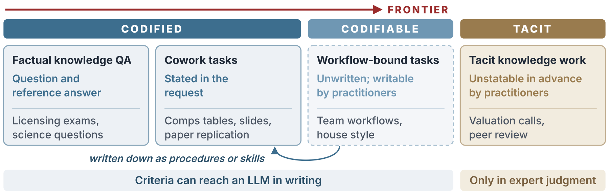
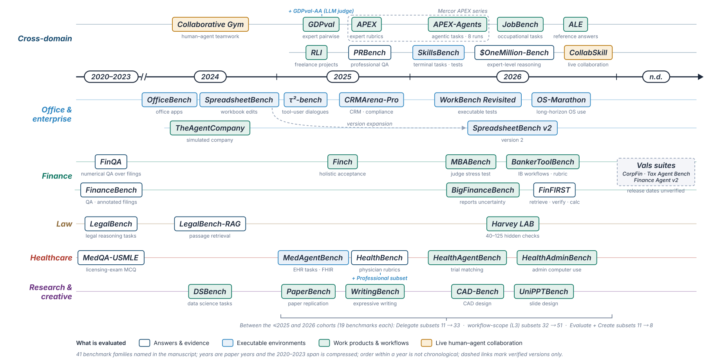
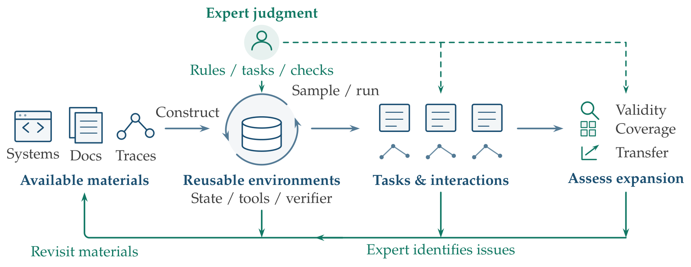
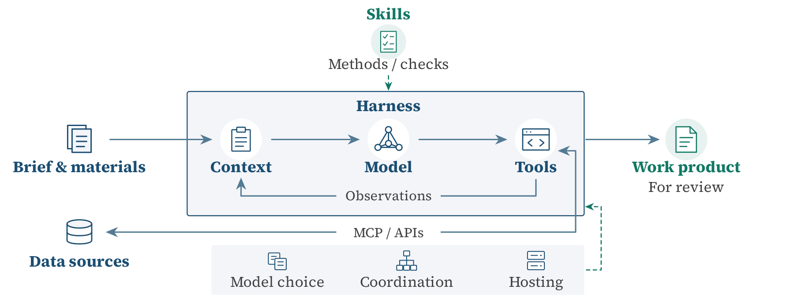
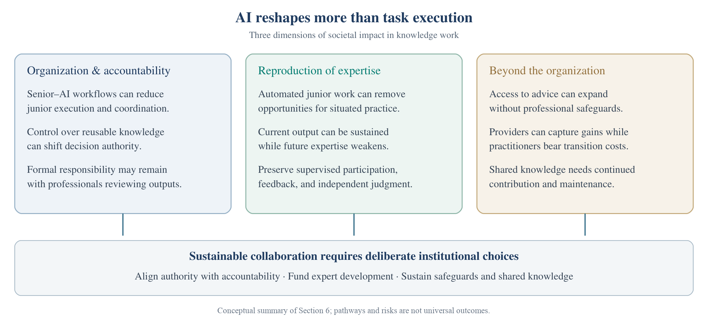

<h1>Paper List</h1>

All <b>196</b> works cited in <i>Knowledge Work in the Age of LLM Agents: Learning the Tacit Dimension of Expertise</i>, organized by the section that discusses them.

<a href="../../README.md">← Back to the survey</a>

Each work appears once, under the section that cites it most often; within each topic, works run from newest to oldest. The pages are generated from the paper's LaTeX source. To suggest a missing work, open an issue.

## Sections

| | Section | Topics | Works |
|:---:|---|---|---:|
|  | **[Section 2 · Conceptual Framework](conceptual-framework.md)** What knowledge work is, how codified, codifiable, and tacit knowledge differ, and the three stages of a task. | [Definition and Scope](conceptual-framework.md#definition-and-scope) · [Tacit Knowledge Work](conceptual-framework.md#tacit-knowledge-work) · [Three Stages](conceptual-framework.md#three-stages) | 31 |
|  | **[Section 3 · Evaluation](evaluation.md)** Benchmarks for professional work, how their tasks are built, and how open-ended outputs are scored. | [Benchmark Landscape](evaluation.md#benchmark-landscape) · [Task Construction](evaluation.md#task-construction) · [Scoring and Calibration](evaluation.md#scoring-and-calibration) · [Trends and Open Gaps](evaluation.md#trends-and-open-gaps) · [Overview and Appendix](evaluation.md#overview-and-appendix) | 36 |
|  | **[Section 4 · Training](training.md)** Training environments, synthesized expert reasoning, and rubrics turned into rewards. | [Scaling Training Environments](training.md#scaling-training-environments) · [Synthesizing Expert Reasoning](training.md#synthesizing-expert-reasoning) · [Synthesizing Rubrics for Scalable Supervision](training.md#synthesizing-rubrics-for-scalable-supervision) · [Overview and Appendix](training.md#overview-and-appendix) | 32 |
|  | **[Section 5 · Deployment](deployment.md)** Professional data and context, skills and procedures, tools and harnesses, and specialized models. | [Professional Data and Institutional Context](deployment.md#professional-data-and-institutional-context) · [Skills and Professional Procedures](deployment.md#skills-and-professional-procedures) · [Tool Integration and Workflow Execution](deployment.md#tool-integration-and-workflow-execution) · [Specialized Models and Deployment Choices](deployment.md#specialized-models-and-deployment-choices) · [Overview and Appendix](deployment.md#overview-and-appendix) | 46 |
|  | **[Section 6 · Societal Impacts](societal-impacts.md)** Organizational change and accountability, the reproduction of expertise, and costs beyond the firm. | [Organizational Structure and Accountability](societal-impacts.md#organizational-structure-and-accountability) · [Reproducing Expertise](societal-impacts.md#reproducing-expertise) · [Impacts Beyond Organizational Boundaries](societal-impacts.md#impacts-beyond-organizational-boundaries) | 46 |
|  | **[Introduction and Outlook](introduction-and-outlook.md)** Works cited only in the introduction and the outlook. | [Overview and Appendix](introduction-and-outlook.md#overview-and-appendix) | 5 |

## Reading Paths

Short starting points for common questions.

### Understanding tacit knowledge

*Start from the classic accounts, then the economics of codification.*

| Year | Work | Venue | Section |
|:---:|---|---|---|
| 1966 | **The Tacit Dimension** Polanyi | Doubleday | [Conceptual Framework](conceptual-framework.md) |
| 2010 | **[Tacit and Explicit Knowledge](https://doi.org/10.7208/chicago/9780226113821.001.0001)** Collins | University of Chicago Press | [Conceptual Framework](conceptual-framework.md) |
| 2000 | **[The Explicit Economics of Knowledge Codification and Tacitness](https://doi.org/10.1093/icc/9.2.211)** Cowan et al. | Industrial and Corporate Change | [Conceptual Framework](conceptual-framework.md) |
| 2005 | **[Do We Really Understand Tacit Knowledge?](https://doi.org/10.1093/oso/9780199275571.003.0007)** Tsoukas | Complex Knowledge: Studies in Organizational Epistemology | [Conceptual Framework](conceptual-framework.md) |

### Evaluating agents on professional work

*Benchmarks built from real assignments, and how their graders are validated.*

| Year | Work | Venue | Section |
|:---:|---|---|---|
| 2025 | **[GDPval: Evaluating AI Model Performance on Real-World Economically Valuable Tasks](https://arxiv.org/html/2510.04374)** Patwardhan et al. | arXiv | [Evaluation](evaluation.md) |
| 2026 | **[Introducing Harvey's Legal Agent Benchmark](https://www.harvey.ai/blog/introducing-harveys-legal-agent-benchmark)** Harvey | — | [Evaluation](evaluation.md) |
| 2026 | **[APEX-Agents](https://arxiv.org/html/2601.14242v3)** Vidgen et al. | arXiv | [Evaluation](evaluation.md) |
| 2024 | **[Who Validates the Validators? Aligning LLM-Assisted Evaluation of LLM Outputs with Human Preferences](https://arxiv.org/html/2404.12272)** Shankar et al. | arXiv | [Evaluation](evaluation.md) |

### Learning from expert feedback

*How expert judgments become rewards and training signal.*

| Year | Work | Venue | Section |
|:---:|---|---|---|
| 2025 | **[Rubrics as Rewards: Reinforcement Learning Beyond Verifiable Domains](https://arxiv.org/abs/2507.17746v2)** Gunjal et al. | arXiv | [Training](training.md) |
| 2026 | **[Augmenting Human Preference in Complex Domains](https://www.harvey.ai/blog/augmenting-human-preference-in-complex-domains)** Pereyra | — | [Training](training.md) |
| 2026 | **[Large Language Models Can Explain Experts Better Than Experts Themselves](https://arxiv.org/abs/2608.07488v2)** Cho et al. | arXiv | [Conceptual Framework](conceptual-framework.md) |

### AI and the training of new experts

*Why automating junior work threatens how expertise is reproduced.*

| Year | Work | Venue | Section |
|:---:|---|---|---|
| 1991 | **[Situated Learning: Legitimate Peripheral Participation](https://doi.org/10.1017/CBO9780511815355)** Lave and Wenger | Cambridge University Press | [Conceptual Framework](conceptual-framework.md) |
| 2019 | **[Shadow Learning: Building Robotic Surgical Skill When Approved Means Fail](https://doi.org/10.1177/0001839217751692)** Beane | Administrative Science Quarterly, 64(1), 87–123 | [Societal Impacts](societal-impacts.md) |
| 2025 | **[Training in the Age of AI: A Theory of Career Viability](https://cepr.org/publications/dp20634)** Garicano and Rayo | CEPR Discussion Paper No. 20634 | [Societal Impacts](societal-impacts.md) |
| 2026 | **[Canaries in the Coal Mine? Six Facts about the Recent Employment Effects of Artificial Intelligence](https://digitaleconomy.stanford.edu/publications/canaries-in-the-coal-mine/)** Brynjolfsson et al. | Working paper, Stanford Digital Economy Lab | [Societal Impacts](societal-impacts.md) |
