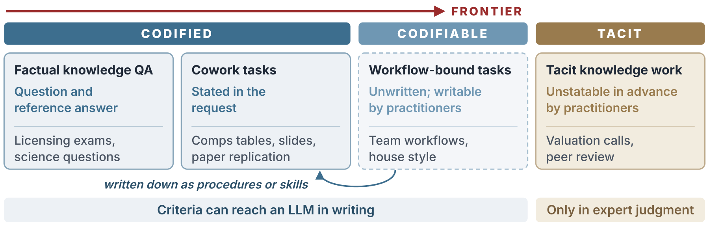

<h1>Section 2 · Conceptual Framework</h1>

<i>What knowledge work is, how codified, codifiable, and tacit knowledge differ, and the three stages of a task.</i>

<b>31</b> works · <b>3</b> topics

<a href="README.md">All sections</a> &nbsp;·&nbsp; <a href="evaluation.md">Evaluation →</a>

Knowledge work by the state of its success criteria. Writing codifiable criteria down as procedures or skills moves the work to the codified side. The frontier of AI has crossed codified work into codifiable work; tacit work lies beyond it.

## Definition and Scope

| Year | Work | Venue |
|:---:|---|---|
| 2024 | **[GPTs are GPTs: Labor Market Impact Potential of LLMs](https://doi.org/10.1126/science.adj0998)** Eloundou et al. | Science |
| 2021 | **[Polanyi's Revenge and AI's New Romance with Tacit Knowledge](https://doi.org/10.1145/3446369)** Kambhampati | Communications of the ACM |
| 2003 | **[The Skill Content of Recent Technological Change: An Empirical Exploration](https://doi.org/10.1162/003355303322552801)** Autor et al. | The Quarterly Journal of Economics |
| 1999 | **[Knowledge-Worker Productivity: The Biggest Challenge](https://doi.org/10.2307/41165987)** Drucker | California Management Review |
| 1994 | **[A Dynamic Theory of Organizational Knowledge Creation](https://doi.org/10.1287/orsc.5.1.14)** Nonaka | Organization Science |
| 1988 | **The System of Professions: An Essay on the Division of Expert Labor** Abbott | University of Chicago Press |
| 1973 | **[The Structure of Ill Structured Problems](https://doi.org/10.1016/0004-3702(73)90011-8)** Simon | Artificial Intelligence |
| 1962 | **The Production and Distribution of Knowledge in the United States** Machlup | Princeton University Press |
| 1959 | **Landmarks of Tomorrow** Drucker | Harper & Brothers |
| 1958 | **Personal Knowledge: Towards a Post-Critical Philosophy** Polanyi | University of Chicago Press |

<a href="#top">↑ Top</a>

## Tacit Knowledge Work

| Year | Work | Venue |
|:---:|---|---|
| 2026 | **[Large Language Models Can Explain Experts Better Than Experts Themselves](https://arxiv.org/abs/2608.07488v2)** Cho et al. | arXiv |
| 2026 | **[Vals AI Enterprise Benchmarks: Corporate Finance, Mortgage Tax, Case Law, and Legal Research](https://www.vals.ai/benchmarks)** Vals AI | — |
| 2026 | **[What Aspects of Tacit Knowledge Are Structurally Excluded from Generative AI? A Conceptual Framework of Mediation, Structure, and Representation](https://doi.org/10.54941/ahfe1007726)** Onoda and Ito | The Human Side of Service Engineering |
| 2025 | **[PaperBench: Evaluating AI's Ability to Replicate AI Research](https://arxiv.org/html/2504.01848)** Starace et al. | arXiv |
| 2024 | **[GPT-4 Passes the Bar Exam](https://doi.org/10.1098/rsta.2023.0254)** Katz et al. | Philosophical Transactions of the Royal Society A |
| 2023 | **[GPQA: A Graduate-Level Google-Proof Q&A Benchmark](https://arxiv.org/abs/2311.12022)** Rein et al. | arXiv |
| 2023 | **[Large Language Models Encode Clinical Knowledge](https://doi.org/10.1038/s41586-023-06291-2)** Singhal et al. | Nature |
| 2022 | **[A Review on Language Models as Knowledge Bases](https://arxiv.org/abs/2204.06031)** AlKhamissi et al. | arXiv |
| 2020 | **[How Much Knowledge Can You Pack Into the Parameters of a Language Model?](https://aclanthology.org/2020.emnlp-main.437/)** Roberts et al. | EMNLP |
| 2020 | **[Retrieval-Augmented Generation for Knowledge-Intensive NLP Tasks](https://arxiv.org/abs/2005.11401)** Lewis et al. | arXiv |
| 2019 | **[Language Models as Knowledge Bases?](https://doi.org/10.18653/v1/D19-1250)** Petroni et al. | EMNLP |
| 2010 | **[Tacit and Explicit Knowledge](https://doi.org/10.7208/chicago/9780226113821.001.0001)** Collins | University of Chicago Press |
| 2005 | **[Do We Really Understand Tacit Knowledge?](https://doi.org/10.1093/oso/9780199275571.003.0007)** Tsoukas | Complex Knowledge: Studies in Organizational Epistemology |
| 2001 | **A Taxonomy for Learning, Teaching, and Assessing: A Revision of Bloom's Taxonomy of Educational Objectives** Anderson and Krathwohl | Longman |
| 2000 | **[The Explicit Economics of Knowledge Codification and Tacitness](https://doi.org/10.1093/icc/9.2.211)** Cowan et al. | Industrial and Corporate Change |
| 1991 | **[Situated Learning: Legitimate Peripheral Participation](https://doi.org/10.1017/CBO9780511815355)** Lave and Wenger | Cambridge University Press |
| 1966 | **The Tacit Dimension** Polanyi | Doubleday |
| 1949 | **The Concept of Mind** Ryle | Hutchinson |

<a href="#top">↑ Top</a>

## Three Stages

| Year | Work | Venue |
|:---:|---|---|
| 1997 | **Formal and Real Authority in Organizations** Aghion and Tirole | Journal of Political Economy |
| 1983 | **Separation of Ownership and Control** Fama and Jensen | The Journal of Law and Economics |
| 1983 | **The Reflective Practitioner: How Professionals Think in Action** Schon | Basic Books |

<a href="#top">↑ Top</a>

---

<a href="README.md">All sections</a> &nbsp;·&nbsp; <a href="evaluation.md">Evaluation →</a>

