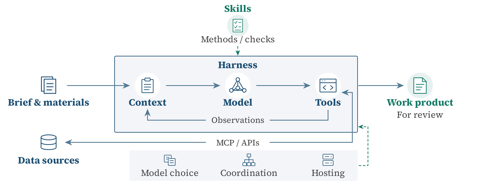

<h1>Section 5 · Deployment</h1>

<i>Professional data and context, skills and procedures, tools and harnesses, and specialized models.</i>

<b>46</b> works · <b>5</b> topics

<a href="training.md">← Training</a> &nbsp;·&nbsp; <a href="README.md">All sections</a> &nbsp;·&nbsp; <a href="societal-impacts.md">Societal Impacts →</a>

Deployment integrates case materials, retrieved evidence, skills, models, and tools to produce work for professional review.

## Professional Data and Institutional Context

| Year | Work | Venue |
|:---:|---|---|
| 2026 | **[BioMCP: Biomedical Data Access for Agents](https://github.com/genomoncology/biomcp/tree/4050fdc7dbdf4d713d94cf02a39a147b863665be)** BioMCP Contributors | — |
| 2026 | **[Claude for Financial Services: Reference Agents, Skills, and Data Connectors](https://github.com/anthropics/financial-services/tree/574ed3624aebd0418c7e96cd101262f30210ab26)** Anthropic | — |
| 2026 | **[FinFIRST: Financial Information Retrieval, Sourcing and Traceability](https://huggingface.co/datasets/inclusionAI/FinFIRST/blob/1d062a63d6e58b398d162658ffd49731f12512a6/README.md)** Ant Group | — |
| 2026 | **[Introducing Harvey II](https://www.harvey.ai/blog/introducing-harvey-ii)** Harvey Team | — |
| 2026 | **[Microsoft Copilot Overview](https://learn.microsoft.com/en-us/microsoft-365/copilot/copilot-overview)** Microsoft | — |
| 2026 | **[Pkulaw MCP Legal Services Platform](https://mcp.pkulaw.com/)** Pkulaw | — |
| 2024 | **[LegalBench-RAG: A Benchmark for Retrieval-Augmented Generation in the Legal Domain](https://arxiv.org/abs/2408.10343v1)** Pipitone and Alami | arXiv |
| 2024 | **[Lost in the Middle: How Language Models Use Long Contexts](https://aclanthology.org/2024.tacl-1.9/)** Liu et al. | Transactions of the Association for Computational Linguistics |
| 2024 | **[The Findings of Our First Generative AI Experiment: GOV.UK Chat](https://insidegovuk.blog.gov.uk/2024/01/18/the-findings-of-our-first-generative-ai-experiment-gov-uk-chat/)** Government Digital Service | Inside GOV.UK |
| 2024 | **[Tutor CoPilot: A Human-AI Approach for Scaling Real-Time Expertise](https://arxiv.org/abs/2410.03017v3)** Wang et al. | arXiv preprint arXiv:2410.03017 |
| 2023 | **[FinanceBench: A New Benchmark for Financial Question Answering](https://arxiv.org/abs/2311.11944)** Islam et al. | arXiv |
| 2023 | **[MedAlign: A Clinician-Generated Dataset for Instruction Following with Electronic Medical Records](https://arxiv.org/abs/2308.14089v2)** Fleming et al. | arXiv |

<a href="#top">↑ Top</a>

## Skills and Professional Procedures

| Year | Work | Venue |
|:---:|---|---|
| 2026 | **[Agent Skills Specification](https://agentskills.io/specification)** Agent Skills | — |
| 2026 | **[Legal-Skills-Chinese: Chinese Legal Reasoning Skills](https://github.com/THUYRan/Legal-Skills-Chinese/tree/c31ef1f022be6bcb3e31c1a2374d1d8240ffa61f)** Legal-Skills-Chinese Contributors | — |
| 2026 | **[SkillRefine: Cross-Source Skill Induction and Execution Validation for LLM Agents in Refinery Planning Software](https://arxiv.org/abs/2609.30674v1)** Liu et al. | arXiv |
| 2026 | **[SkillsBench: Benchmarking How Well Agent Skills Work Across Diverse Tasks](https://arxiv.org/html/2602.12670v4)** Li et al. | arXiv |
| 2026 | **[Towards Expert-level Medical AI for Real-time Video Consultations](https://arxiv.org/abs/2608.09861v1)** Nagda et al. | arXiv |
| 2024 | **[Bridging the Novice-Expert Gap via Models of Decision-Making: A Case Study on Remediating Math Mistakes](https://aclanthology.org/2024.naacl-long.120/)** Wang et al. | NAACL |

<a href="#top">↑ Top</a>

## Tool Integration and Workflow Execution

| Year | Work | Venue |
|:---:|---|---|
| 2026 | **[Baichuan-M4: A Clinical-Grade Medical Agent System for Continuous Care](https://arxiv.org/abs/2606.08982v2)** Yang et al. | arXiv |
| 2026 | **[Claude for Healthcare: Connectors and Workflow Reference Implementations](https://github.com/anthropics/healthcare/tree/c7ed150d376bdd13219eb0bfeb4203e12da85516)** Anthropic | — |
| 2026 | **[Customer Support: API Access, Usage Limits, and Market Data](https://www.alphavantage.co/support/)** Alpha Vantage | — |
| 2026 | **[FinanceHarness: Autonomous Financial Deep Research Framework](https://arxiv.org/abs/2607.27853v1)** Xiao et al. | arXiv |
| 2026 | **[Harness Scaling for Generalizable Agentic Reinforcement Learning](https://arxiv.org/abs/2610.29458v1)** Bai et al. | arXiv |
| 2026 | **[LangGraph: Interrupts](https://docs.langchain.com/oss/python/langgraph/interrupts)** LangChain | — |
| 2026 | **[MedicalHarness: A Controlled Evaluation of LLMs and Agent Harnesses on Medical Tasks](https://arxiv.org/abs/2610.05778v1)** Wang et al. | arXiv |
| 2026 | **[Model Context Protocol: Architecture Overview](https://modelcontextprotocol.io/docs/2026-07-28/learn/architecture)** Model Context Protocol Contributors | — |
| 2025 | **[ToolRL: Reward Is All Tool Learning Needs](https://arxiv.org/abs/2504.13958v1)** Qian et al. | arXiv |
| 2023 | **[ReAct: Synergizing Reasoning and Acting in Language Models](https://arxiv.org/abs/2210.03629)** Yao et al. | ICLR |
| 2023 | **[ToolLLM: Facilitating Large Language Models to Master 16000+ Real-World APIs](https://arxiv.org/abs/2307.16789)** Qin et al. | arXiv |

<a href="#top">↑ Top</a>

## Specialized Models and Deployment Choices

| Year | Work | Venue |
|:---:|---|---|
| 2026 | **[A prospective clinical feasibility study of a conversational diagnostic AI in an ambulatory primary care clinic](https://arxiv.org/abs/2603.08448v2)** Brodeur et al. | arXiv |
| 2026 | **[GLM-Legal: Advancing Agentic Legal Intelligence](https://z.ai/blog/glm-legal)** Z.ai | — |
| 2026 | **[Harvey's Legal Agent Benchmark v1 Leaderboard](https://www.vals.ai/benchmarks/hlab-v1)** Vals AI | — |
| 2026 | **[Ling-3.0-flash-Fin Model Card](https://huggingface.co/inclusionAI/Ling-3.0-flash-Fin/blob/a5b4afb48f526175991724472c179e5a065604de/README.md)** Ant Group | — |
| 2026 | **[MedGemma 1.5 Model Card](https://developers.google.com/health-ai-developer-foundations/medgemma/model-card)** Google | — |
| 2026 | **[MedGemma: Health AI Developer Foundations](https://developers.google.com/health-ai-developer-foundations/medgemma)** Google | — |
| 2026 | **[Post-Training RLM Agents for End-to-End M&A Diligence](https://www.harvey.ai/blog/post-training-rlm-agents-for-m-and-a-diligence)** Grupen et al. | — |
| 2026 | **[Security and Data Privacy](https://www.harvey.ai/security)** Harvey | — |
| 2024 | **[RouteLLM: Learning to Route LLMs with Preference Data](https://arxiv.org/abs/2406.18665v1)** Ong et al. | arXiv |

<a href="#top">↑ Top</a>

## Overview and Appendix

| Year | Work | Venue |
|:---:|---|---|
| 2026 | **[Ling-3.0-flash-Sante Model Card](https://huggingface.co/inclusionAI/Ling-3.0-flash-Sante/blob/f74bd27bd26ffc71a50dd847805f8f7666ff0b43/README.md)** Ant Group | — |
| 2025 | **[Interpretation on Issues Concerning the Application of Law in the Trial of Labour Dispute Cases (II)](http://gongbao.court.gov.cn/Details/bb72019c45453f84d920bd6375573e.html)** Supreme People's Court of the People's Republic of China | Judicial interpretation, Fa Shi [2025] No. 12, in Gazette of the Supreme People's Court, 2025, No. 10 |
| 2020 | **[Decision Repealing Certain Judicial Interpretations and Related Normative Documents](https://www.court.gov.cn/fabu/xiangqing/282061.html)** Supreme People's Court of the People's Republic of China | Fa Shi [2020] No. 16 |
| 2020 | **[Interpretation on Issues Concerning the Application of Law in the Trial of Labour Dispute Cases (I)](https://www.court.gov.cn/fabu/xiangqing/282121.html)** Supreme People's Court of the People's Republic of China | Judicial interpretation, Fa Shi [2020] No. 26 |
| 2019 | **[Shenzhen Special Economic Zone Regulations on Protection of Enterprise Technical Secrets](https://www.sz.gov.cn/zfgb/2020/gb1164/content/post_8047987.html)** Standing Committee of the Shenzhen Municipal People's Congress | Shenzhen Municipal People's Government Gazette, 2020, No. 34 |
| 2013 | **[Interpretation on Several Issues Concerning the Application of Law in the Trial of Labour Dispute Cases (IV)](https://www.court.gov.cn/fabu/xiangqing/5064.html)** Supreme People's Court of the People's Republic of China | Historical judicial interpretation, Fa Shi [2013] No. 4 |
| 2013 | **[Jiangsu Labour Contract Regulations](https://sft.jiangsu.gov.cn/art/2015/5/18/art_71926_8103093.html)** Standing Committee of the Jiangsu Provincial People's Congress | Full text published by the Jiangsu Provincial Department of Justice |
| 2012 | **[Labour Contract Law of the People's Republic of China](https://www.beijing.gov.cn/zhengce/zhengcefagui/qtwj/201307/t20130701_780700.html)** Standing Committee of the National People's Congress | Full text published by the Beijing Municipal People's Government |

<a href="#top">↑ Top</a>

---

<a href="training.md">← Training</a> &nbsp;·&nbsp; <a href="README.md">All sections</a> &nbsp;·&nbsp; <a href="societal-impacts.md">Societal Impacts →</a>

