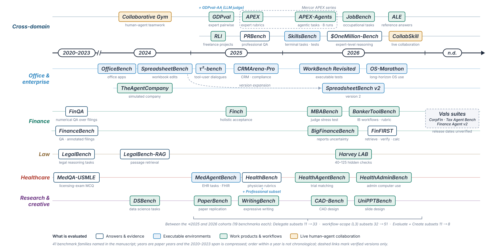

<h1>Section 3 · Evaluation</h1>

<i>Benchmarks for professional work, how their tasks are built, and how open-ended outputs are scored.</i>

<b>36</b> works · <b>5</b> topics

<a href="conceptual-framework.md">← Conceptual Framework</a> &nbsp;·&nbsp; <a href="README.md">All sections</a> &nbsp;·&nbsp; <a href="training.md">Training →</a>

Timeline of 41 benchmark families, grouped by evaluation focus. This selection differs from the 44-benchmark statistical catalog.

## Benchmark Landscape

| Year | Work | Venue |
|:---:|---|---|
| 2026 | **[APEX-Agents](https://arxiv.org/html/2601.14242v3)** Vidgen et al. | arXiv |
| 2026 | **[HealthAgentBench: A Unified Benchmark Suite of Realistic Agentic Healthcare Environments for Challenging Frontier AI Agents](https://arxiv.org/html/2606.31179)** Liu et al. | arXiv |
| 2026 | **[Introducing Harvey's Legal Agent Benchmark](https://www.harvey.ai/blog/introducing-harveys-legal-agent-benchmark)** Harvey | — |
| 2026 | **[JobBench: Aligning Agent Work with Human Will](https://arxiv.org/html/2605.26329v1)** Li et al. | arXiv |
| 2026 | **[UniPPTBench: A Unified Benchmark for Presentation Generation Across Diverse Input Settings](https://arxiv.org/html/2605.17356v1)** Zhao et al. | arXiv |
| 2025 | **[CRMArena-Pro: Holistic Assessment of LLM Agents Across Diverse Business Scenarios and Interactions](https://arxiv.org/html/2505.18878v1)** Huang et al. | arXiv |
| 2025 | **[GDPval: Evaluating AI Model Performance on Real-World Economically Valuable Tasks](https://arxiv.org/html/2510.04374)** Patwardhan et al. | arXiv |
| 2025 | **[HealthBench: Evaluating Large Language Models Towards Improved Human Health](https://arxiv.org/abs/2505.08775)** Arora et al. | arXiv |
| 2025 | **[MedAgentBench: A Realistic Virtual EHR Environment to Benchmark Medical LLM Agents](https://arxiv.org/abs/2501.14654)** Jiang et al. | arXiv |
| 2025 | **[Remote Labor Index: Measuring AI Automation of Remote Work](https://arxiv.org/html/2510.26787)** Mazeika et al. | arXiv |
| 2025 | **[WritingBench: A Comprehensive Benchmark for Generative Writing](https://arxiv.org/html/2503.05244)** Wu et al. | arXiv |

<a href="#top">↑ Top</a>

## Task Construction

| Year | Work | Venue |
|:---:|---|---|
| 2026 | **[Agents' Last Exam](https://arxiv.org/abs/2606.05405v2)** Sun et al. | arXiv |
| 2026 | **[Labor Market Impacts of AI: A New Measure and Early Evidence](https://www.anthropic.com/research/labor-market-impacts)** Massenkoff and McCrory | Research report, Anthropic |
| 2026 | **[OS-Marathon: Benchmarking Computer-Use Agents on Vast-Horizon, Repetitive Tasks](https://arxiv.org/html/2601.20650)** Wu et al. | arXiv |
| 2024 | **[DSBench: How Far Are Data Science Agents from Becoming Data Science Experts?](https://github.com/LiqiangJing/DSBench)** Jing et al. | arXiv |
| 2024 | **[TheAgentCompany: Benchmarking LLM Agents on Consequential Real World Tasks](https://arxiv.org/html/2412.14161v2)** Xu et al. | arXiv |
| 1979 | **A Conceptual Framework for the Design of Organizational Control Mechanisms** Ouchi | Management Science |

<a href="#top">↑ Top</a>

## Scoring and Calibration

| Year | Work | Venue |
|:---:|---|---|
| 2026 | **[A Judge Should Know What Changed: Construct Validity for LLM-as-a-Judge Evaluation](https://arxiv.org/html/2608.24419v1)** Chen et al. | arXiv |
| 2026 | **[BigFinanceBench: A Workflow-Grounded Benchmark for Financial-Research Agents](https://arxiv.org/html/2606.03829)** Wang et al. | arXiv |
| 2026 | **[Harvey LAB: Evaluation Strategies and Scoring Documentation](https://github.com/harveyai/harvey-labs/blob/main/docs/eval-strategies.md)** Harvey | — |
| 2026 | **[Intelligence Benchmarking: GDPval-AA Methodology](https://artificialanalysis.ai/methodology/intelligence-benchmarking#gdpval-aa)** Artificial Analysis | — |
| 2026 | **[MBABench: Evaluating LLM Agents on End-to-End Spreadsheet Tasks in Finance](https://arxiv.org/html/2605.22664)** Yen et al. | arXiv |
| 2026 | **[Mubric: Mutation Testing-Guided Rubric Generation for LLM Evaluation](https://arxiv.org/html/2609.37322v1)** Yang et al. | arXiv |
| 2026 | **[The Anthropic Economic Index](https://huggingface.co/datasets/Anthropic/EconomicIndex)** Anthropic | Public dataset and technical report |
| 2026 | **[WorkBench Revisited: Workplace Agents Two Years On](https://arxiv.org/html/2606.13715v2)** Styles and Miller | arXiv |
| 2025 | **[AI Adoption in the Census Business Trends and Outlook Survey (BTOS)](https://github.com/EIG-Research/ai-btos)** Economic Innovation Group | Public replication repository |
| 2025 | **[Finch: Benchmarking Finance & Accounting across Spreadsheet-Centric Enterprise Workflows](https://arxiv.org/html/2512.13168)** Dong et al. | arXiv |
| 2025 | **[The AI Productivity Index (APEX)](https://arxiv.org/html/2509.25721)** Vidgen et al. | arXiv |
| 2024 | **[Who Validates the Validators? Aligning LLM-Assisted Evaluation of LLM Outputs with Human Preferences](https://arxiv.org/html/2404.12272)** Shankar et al. | arXiv |
| 2021 | **[FinQA: A Dataset of Numerical Reasoning over Financial Data](https://aclanthology.org/2021.emnlp-main.300/)** Chen et al. | EMNLP |

<a href="#top">↑ Top</a>

## Trends and Open Gaps

| Year | Work | Venue |
|:---:|---|---|
| 2026 | **[CollabSkill: Evaluating Human-Agent Collaboration On Real-World Tasks](https://arxiv.org/html/2606.09833)** Shao et al. | arXiv |
| 2024 | **[Collaborative Gym: A Framework for Enabling and Evaluating Human-Agent Collaboration](https://arxiv.org/html/2412.15701v6)** Shao et al. | arXiv |

<a href="#top">↑ Top</a>

## Overview and Appendix

| Year | Work | Venue |
|:---:|---|---|
| 2026 | **[\$OneMillion-Bench: How Far are Language Agents from Human Experts?](https://arxiv.org/html/2603.07980v1)** Yang et al. | arXiv |
| 2026 | **[CAD-bench: Benchmarking Language Models on Functional CAD Generation](https://icml.cc/virtual/2026/67851)** Saini | The Second Workshop on Agents in the Wild: Safety, Security, and Beyond (AIWILD), ICML 2026 |
| 2026 | **[Designing Benchmarks for Knowledge Work](https://arxiv.org/html/2605.23262v2)** Hua et al. | arXiv |
| 2025 | **[PRBench: Large-Scale Expert Rubrics for Evaluating High-Stakes Professional Reasoning](https://arxiv.org/html/2511.11562v1)** Akyurek et al. | arXiv |

<a href="#top">↑ Top</a>

---

<a href="conceptual-framework.md">← Conceptual Framework</a> &nbsp;·&nbsp; <a href="README.md">All sections</a> &nbsp;·&nbsp; <a href="training.md">Training →</a>

