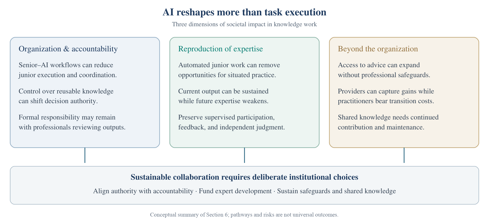

<h1>Section 6 · Societal Impacts</h1>

<i>Organizational change and accountability, the reproduction of expertise, and costs beyond the firm.</i>

<b>46</b> works · <b>3</b> topics

<a href="deployment.md">← Deployment</a> &nbsp;·&nbsp; <a href="README.md">All sections</a> &nbsp;·&nbsp; <a href="introduction-and-outlook.md">Introduction and Outlook →</a>

Repository illustration of Section 6: organizational structure and accountability, reproduction of expertise, and impacts beyond organizational boundaries.

## Organizational Structure and Accountability

| Year | Work | Venue |
|:---:|---|---|
| 2026 | **[Canaries in the Coal Mine? Six Facts about the Recent Employment Effects of Artificial Intelligence](https://digitaleconomy.stanford.edu/publications/canaries-in-the-coal-mine/)** Brynjolfsson et al. | Working paper, Stanford Digital Economy Lab |
| 2026 | **[High Interest but Low Adoption: Navigating Organizations' Journey towards Generative Artificial Intelligence Implementation](https://doi.org/10.1016/j.ijinfomgt.2025.103009)** Wang et al. | International Journal of Information Management, 87, 103009 |
| 2026 | **[Who Will Become the Next Senior? How Generative AI Erodes the Development Pathway in Software Engineering](https://arxiv.org/abs/2607.17067v3)** Yu and Moon | arXiv preprint arXiv:2607.17067 |
| 2025 | **[Generative AI and Organizational Structure in the Knowledge Economy](https://arxiv.org/abs/2506.00532v2)** Xu et al. | arXiv preprint arXiv:2506.00532 |
| 2025 | **[Generative AI and the Nature of Work](https://papers.ssrn.com/sol3/papers.cfm?abstract_id=5007084)** Hoffmann et al. | Harvard Business School Working Paper No. 25-021 |
| 2025 | **[Generative AI as Seniority-Biased Technological Change: Evidence from U.S. Resume and Job Posting Data](https://papers.ssrn.com/sol3/papers.cfm?abstract_id=5425555)** Hosseini and Lichtinger | Working paper, SSRN 5425555 |
| 2025 | **[Generative AI at Work](https://doi.org/10.1093/qje/qjae044)** Brynjolfsson et al. | The Quarterly Journal of Economics, 140(2), 889–942 |
| 2025 | **[Strategic Adoption of Generative AI in Organizations: A Game-Theoretic and Network-Based Approach](https://doi.org/10.1016/j.ijinfomgt.2025.102932)** Seifdar and Amiri | International Journal of Information Management, 84, 102932 |
| 2025 | **[The State of AI in 2025: Agents, Innovation, and Transformation](https://www.mckinsey.com/~/media/mckinsey/business%20functions/quantumblack/our%20insights/the%20state%20of%20ai/november%202025/the-state-of-ai-2025-agents-innovation_cmyk-v1.pdf)** Singla et al. | Survey report, McKinsey & Company |
| 2023 | **[Dislocated Accountabilities in the “AI Supply Chain”: Modularity and Developers' Notions of Responsibility](https://doi.org/10.1177/20539517231177620)** Widder and Nafus | Big Data & Society, 10(1) |
| 2023 | **[Firm Investments in Artificial Intelligence Technologies and Changes in Workforce Composition](https://www.nber.org/papers/w31325)** Babina et al. | NBER Working Paper No. 31325 |
| 2021 | **[Is AI Ground Truth Really True? The Dangers of Training and Evaluating AI Tools Based on Experts' Know-What](https://doi.org/10.25300/MISQ/2021/16564)** Lebovitz et al. | MIS Quarterly, 45(3), 1501–1525 |
| 2021 | **[Make Way for the Algorithms: Symbolic Actions and Change in a Regime of Knowing](https://doi.org/10.1287/orsc.2020.1377)** Pachidi et al. | Organization Science, 32(1), 18–41 |
| 2020 | **[Closing the AI Accountability Gap: Defining an End-to-End Framework for Internal Algorithmic Auditing](https://doi.org/10.1145/3351095.3372873)** Raji et al. | 2020 Conference on Fairness, Accountability, and Transparency, 33–44 |
| 2019 | **[Moral Crumple Zones: Cautionary Tales in Human-Robot Interaction](https://doi.org/10.17351/ests2019.260)** Elish | Engaging Science, Technology, and Society, 5, 40–60 |
| 2007 | **[Analysing and Assessing Accountability: A Conceptual Framework](https://doi.org/10.1111/j.1468-0386.2007.00378.x)** Bovens | European law journal |
| 1993 | **[Engineering Knowledge: The Construction of Knowledge in Artificial Intelligence](https://doi.org/10.1177/0306312793023003002)** Forsythe | Social Studies of Science, 23(3), 445–477 |
| 1980 | **[Structure in 5's: A Synthesis of the Research on Organization Design](https://doi.org/10.1287/mnsc.26.3.322)** Mintzberg | Management Science |

<a href="#top">↑ Top</a>

## Reproducing Expertise

| Year | Work | Venue |
|:---:|---|---|
| 2026 | **[Broken Ladders: AI, Teamwork, and the Dynamics of Skill Formation in the Workplace](https://koren.mk/publications/broken-ladders)** Barany and Koren | Working paper |
| 2026 | **[How AI Impacts Skill Formation](https://arxiv.org/abs/2601.20245v2)** Shen and Tamkin | arXiv preprint arXiv:2601.20245 |
| 2026 | **[SME Technology Adoption in the United Kingdom](https://doi.org/10.1787/5f25ce2a-en)** OECD | OECD Studies on SMEs and Entrepreneurship, OECD Publishing, Paris |
| 2026 | **[When AI Absorbs the Apprenticeship: Rethinking Staff Development and Expertise Formation in Survey Research](https://doi.org/10.29115/SP-2026-0023)** Link | Survey Practice, 20 |
| 2025 | **[Automation, AI, and the Intergenerational Transmission of Knowledge](https://cepr.org/publications/dp20940)** Ide | CEPR Discussion Paper No. 20940 |
| 2025 | **[Generative AI without Guardrails Can Harm Learning: Evidence from High School Mathematics](https://doi.org/10.1073/pnas.2422633122)** Bastani et al. | National Academy of Sciences, 122(26), e2422633122 |
| 2025 | **[Training in the Age of AI: A Theory of Career Viability](https://cepr.org/publications/dp20634)** Garicano and Rayo | CEPR Discussion Paper No. 20634 |
| 2019 | **[Shadow Learning: Building Robotic Surgical Skill When Approved Means Fail](https://doi.org/10.1177/0001839217751692)** Beane | Administrative Science Quarterly, 64(1), 87–123 |
| 2011 | **[Firm-Sponsored Training and Poaching Externalities in Regional Labor Markets](https://doi.org/10.1016/j.regsciurbeco.2011.04.003)** Muehlemann and Wolter | Regional Science and Urban Economics, 41(6), 560–570 |
| 2009 | **[Conditions for Intuitive Expertise: A Failure to Disagree](https://doi.org/10.1037/a0016755)** Kahneman and Klein | American Psychologist |
| 2001 | **[Should Firms Be Required to Pay for Vocational Training?](https://doi.org/10.1111/1468-0297.00647)** Stevens | The Economic Journal, 111(473), 485–505 |
| 1986 | **Mind over Machine: The Power of Human Intuition and Expertise in the Era of the Computer** Dreyfus and Dreyfus | Free Press |
| 1972 | **[Learning and Experience in the Labor Market](https://doi.org/10.2307/145087)** Rosen | The Journal of Human Resources, 7(3), 326–342 |
| 1964 | **[Human Capital: A Theoretical and Empirical Analysis, with Special Reference to Education](https://www.nber.org/books-and-chapters/human-capital-theoretical-and-empirical-analysis-special-reference-education-first-edition)** Becker | Book, National Bureau of Economic Research and Columbia University Press, New York |

<a href="#top">↑ Top</a>

## Impacts Beyond Organizational Boundaries

| Year | Work | Venue |
|:---:|---|---|
| 2026 | **[AI, Human Cognition and Knowledge Collapse](https://www.nber.org/papers/w34910)** Acemoglu et al. | NBER Working Paper No. 34910 |
| 2026 | **[AI-Accelerated Occupational Decline and the Mobility Trap](https://doi.org/10.1257/pandp.20261004)** Song et al. | AEA Papers and Proceedings, 116, 246–250 |
| 2026 | **[Misplaced Trust in Artificial Professional Advice](https://scholarship.law.bu.edu/jostl/vol32/iss1/4/)** Haupt | Journal of Science & Technology Law, 32(1) |
| 2025 | **[Against an AI Privilege](https://jolt.law.harvard.edu/digest/against-an-ai-privilege)** Robbins | Harvard Journal of Law & Technology Digest |
| 2025 | **[Concentrating Intelligence: Scaling and Market Structure in Artificial Intelligence](https://doi.org/10.1093/epolic/eiae057)** Korinek and Vipra | Economic Policy, 40(121), 225–256 |
| 2025 | **[Financial Services Executive? Open AI Wants You](https://www.financemagnates.com/trending/financial-services-executive-open-ai-wants-you/)** Kirui | News article, Finance Magnates |
| 2025 | **[Generative AI and Legal Aid: Results from a Field Study and 100 Use Cases to Bridge the Access to Justice Gap](https://digitalcommons.lmu.edu/llr/vol57/iss4/2/)** Chien and Kim | Loyola of Los Angeles Law Review, 57(4) |
| 2025 | **[Governance of Generative AI in Creative Work: Consent, Credit, Compensation, and Beyond](https://doi.org/10.1145/3706598.3713799)** Kyi et al. | CHI |
| 2024 | **[Large Language Models Reduce Public Knowledge Sharing on Online Q&A Platforms](https://doi.org/10.1093/pnasnexus/pgae400)** del Rio-Chanona et al. | PNAS Nexus, 3(9), pgae400 |
| 2024 | **[The Consequences of Generative AI for Online Knowledge Communities](https://doi.org/10.1038/s41598-024-61221-0)** Burtch et al. | Scientific Reports, 14, Article 10413 |
| 2024 | **[The Short-Term Effects of Generative Artificial Intelligence on Employment: Evidence from an Online Labor Market](https://doi.org/10.1287/orsc.2023.18441)** Hui et al. | Organization Science, 35(6), 1977–1989 |
| 2023 | **[Generative AI and Author Remuneration](https://doi.org/10.1007/s40319-023-01399-4)** Senftleben | IIC – International Review of Intellectual Property and Competition Law, 54, 1535–1560 |
| 2019 | **[Governing A.I.'s Professional Advice](https://lawjournal.mcgill.ca/article/governing-a-i-s-professional-advice/)** Haupt | McGill Law Journal, 64(4), 665–682 |
| 2009 | **[Occupational Specificity of Human Capital](https://doi.org/10.1111/j.1468-2354.2008.00524.x)** Kambourov and Manovskii | International Economic Review, 50(1), 63–115 |

<a href="#top">↑ Top</a>

---

<a href="deployment.md">← Deployment</a> &nbsp;·&nbsp; <a href="README.md">All sections</a> &nbsp;·&nbsp; <a href="introduction-and-outlook.md">Introduction and Outlook →</a>

