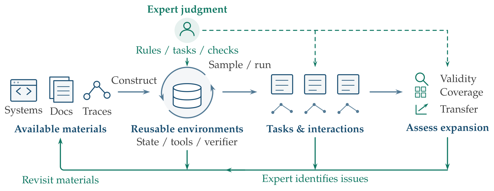

<h1>Section 4 · Training</h1>

<i>Training environments, synthesized expert reasoning, and rubrics turned into rewards.</i>

<b>32</b> works · <b>4</b> topics

<a href="evaluation.md">← Evaluation</a> &nbsp;·&nbsp; <a href="README.md">All sections</a> &nbsp;·&nbsp; <a href="deployment.md">Deployment →</a>

Expanding training supervision through expert-guided environment construction, experience generation, and assessment. Not all surveyed systems implement the full loop.

## Scaling Training Environments

| Year | Work | Venue |
|:---:|---|---|
| 2026 | **[BankerToolBench: Evaluating AI Agents in End-to-End Investment Banking Workflows](https://arxiv.org/abs/2604.11304v1)** Lau et al. | arXiv |
| 2026 | **[CodeMidas: Scaling Agentic Coding RL Environments from Code Itself](https://arxiv.org/abs/2609.22068v1)** Ye et al. | arXiv |
| 2026 | **[EnterpriseBench Corecraft: Training Generalizable Agents on High-Fidelity RL Environments](https://arxiv.org/abs/2602.16179v5)** Mehta et al. | arXiv |
| 2026 | **[EnterpriseLab: A Full-Stack Platform for developing and deploying agents in Enterprises](https://arxiv.org/abs/2603.21630v1)** Agarwal et al. | arXiv |
| 2026 | **[HealthAdminBench: Evaluating Computer-Use Agents on Healthcare Administration Tasks](https://arxiv.org/abs/2604.09937v1)** Bedi et al. | arXiv |
| 2026 | **[ScaleEnv: Scaling Environment Synthesis from Scratch for Generalist Interactive Tool-Use Agent Training](https://arxiv.org/abs/2602.06820v1)** Tu et al. | arXiv |
| 2026 | **[Spreadsheet-RL: Advancing Large Language Model Agents on Realistic Spreadsheet Tasks via Reinforcement Learning](https://arxiv.org/abs/2605.22642v1)** Chi et al. | arXiv |
| 2025 | **[AutoForge: Automated Environment Synthesis for Agentic Reinforcement Learning](https://arxiv.org/abs/2512.22857v1)** Cai et al. | arXiv |
| 2025 | **[Scaling Agent Learning via Experience Synthesis](https://arxiv.org/abs/2511.03773v1)** Chen et al. | arXiv |
| 2025 | **[SWE-smith: Scaling Data for Software Engineering Agents](https://arxiv.org/abs/2504.21798v1)** Yang et al. | arXiv |

<a href="#top">↑ Top</a>

## Synthesizing Expert Reasoning

| Year | Work | Venue |
|:---:|---|---|
| 2026 | **[LegalOne: A Family of Foundation Models for Reliable Legal Reasoning](https://arxiv.org/abs/2602.00642v2)** Li et al. | arXiv |
| 2025 | **[Agentar-DeepFinance-300K: A Large-Scale Financial Dataset via Systematic Chain-of-Thought Synthesis Optimization](https://arxiv.org/abs/2507.12901v1)** Zhao et al. | arXiv |
| 2025 | **[Fino1: On the Transferability of Reasoning-Enhanced LLMs and Reinforcement Learning to Finance](https://arxiv.org/abs/2502.08127v3)** Qian et al. | arXiv |
| 2025 | **[MedReason: Eliciting Factual Medical Reasoning Steps in LLMs via Knowledge Graphs](https://arxiv.org/abs/2504.00993v1)** Wu et al. | arXiv |
| 2023 | **[Language Models Don't Always Say What They Think: Unfaithful Explanations in Chain-of-Thought Prompting](https://arxiv.org/abs/2305.04388v2)** Turpin et al. | arXiv |
| 2023 | **[Let's Verify Step by Step](https://arxiv.org/abs/2305.20050)** Lightman et al. | arXiv |
| 2023 | **[Training Language Models with Language Feedback at Scale](https://arxiv.org/abs/2303.16755)** Scheurer et al. | arXiv |
| 2022 | **[STaR: Bootstrapping Reasoning With Reasoning](https://arxiv.org/abs/2203.14465v2)** Zelikman et al. | arXiv |

<a href="#top">↑ Top</a>

## Synthesizing Rubrics for Scalable Supervision

| Year | Work | Venue |
|:---:|---|---|
| 2026 | **[ARES: Automated Rubric Synthesis for Scalable LLM Reinforcement Learning](https://arxiv.org/abs/2605.23454v2)** Li et al. | arXiv |
| 2026 | **[Augmenting Human Preference in Complex Domains](https://www.harvey.ai/blog/augmenting-human-preference-in-complex-domains)** Pereyra | — |
| 2025 | **[Rubrics as Rewards: Reinforcement Learning Beyond Verifiable Domains](https://arxiv.org/abs/2507.17746v2)** Gunjal et al. | arXiv |

<a href="#top">↑ Top</a>

## Overview and Appendix

| Year | Work | Venue |
|:---:|---|---|
| 2026 | **[InsufficiencyBench: Evaluating LLM Legal Advice on Underspecified User Queries](https://arxiv.org/abs/2608.20220)** Vincent et al. | arXiv |
| 2026 | **[IntentRL: Training Proactive User-intent Agents for Open-ended Deep Research via Reinforcement Learning](https://proceedings.mlr.press/v306/luo26p.html)** Luo et al. | ICML |
| 2026 | **[Mint-Agent: Introducing Finance-Native Agentic Foundation Models](https://arxiv.org/abs/2608.16386v2)** Team et al. | arXiv |
| 2026 | **[PersonaForge: Realistic Multi-Turn User Simulation for Agentic Systems](https://aclanthology.org/2026.findings-emnlp.2181/)** Lv et al. | Findings of the Association for Computational Linguistics: EMNLP 2026 |
| 2026 | **[Training Frontier Review Table Models With Applied Compute](https://www.harvey.ai/blog/training-frontier-review-table-models-with-applied-compute)** Rengarajan et al. | — |
| 2024 | **[AI models collapse when trained on recursively generated data](https://doi.org/10.1038/s41586-024-07566-y)** Shumailov et al. | Nature |
| 2024 | **[On Overcoming Miscalibrated Conversational Priors in LLM-based ChatBots](https://proceedings.mlr.press/v244/herlihy24a.html)** Herlihy et al. | Fortieth Conference on Uncertainty in Artificial Intelligence |
| 2022 | **[Constitutional AI: Harmlessness from AI Feedback](https://arxiv.org/abs/2212.08073)** Bai et al. | arXiv |
| 2010 | **[Complacency and Bias in Human Use of Automation: An Attentional Integration](https://doi.org/10.1177/0018720810376055)** Parasuraman and Manzey | Human Factors |
| 2009 | **[Active Learning Literature Survey](https://minds.wisconsin.edu/handle/1793/60660)** Settles | University of Wisconsin–Madison, Department of Computer Sciences |
| 1983 | **[If nothing goes wrong, is everything all right? Interpreting zero numerators](https://doi.org/10.1001/jama.1983.03330370053031)** Hanley and Lippman-Hand | JAMA |

<a href="#top">↑ Top</a>

---

<a href="evaluation.md">← Evaluation</a> &nbsp;·&nbsp; <a href="README.md">All sections</a> &nbsp;·&nbsp; <a href="deployment.md">Deployment →</a>

